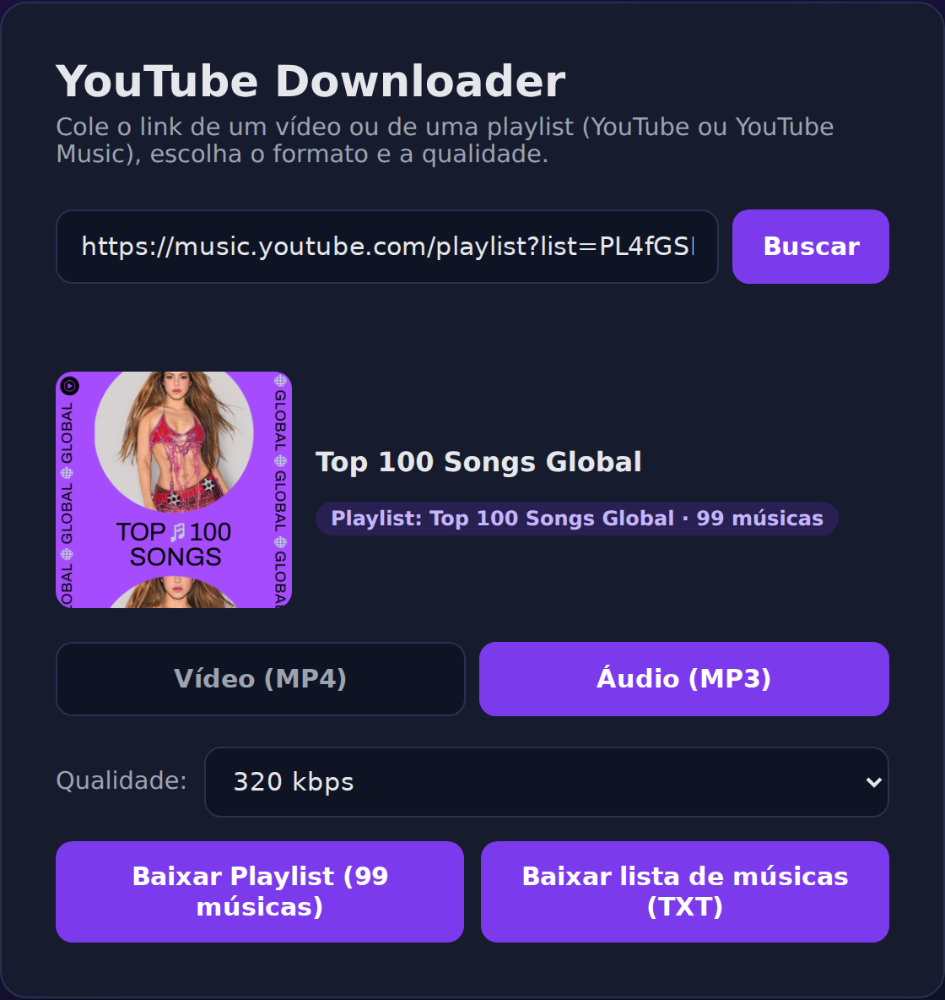

# 🎬 YT Downloader

**Baixe vídeos, músicas e playlists inteiras do YouTube e do YouTube Music direto pelo navegador.**
É só colar o link, escolher o formato e a qualidade, e pronto.

Ele roda no seu computador: nada de sites cheios de anúncios, pop-ups ou limites de download.

<p align="center">
  
</p>

---

## ✨ O que ele faz

- 🎥 **Vídeos em MP4**: escolha a qualidade, de 144p até 4K (conforme o que o vídeo oferece).
- 🎧 **Áudio em MP3**: de 64 a 320 kbps.
- 📂 **Playlists inteiras**: baixa todos os itens e entrega tudo num único arquivo `.zip`, mostrando o progresso de cada um.
- 🎵 **YouTube Music**:
  - Os MP3s já saem com o nome certinho, como `Artista - Música.mp3`, sem "(Official Video)" no nome.
  - **Lista de músicas em TXT**: gera um arquivo com todas as faixas da playlist (artista e título), ótimo para guardar, compartilhar ou recriar a playlist em outro app.
- 🔄 **Pode fechar a aba**: se você recarregar a página no meio do download de uma playlist, ele continua acompanhando de onde parou.
- 🔴 **Lives**: avisa quando o link é de uma transmissão ao vivo que ainda não terminou (essas só podem ser baixadas depois).

### Exemplo da lista de músicas (TXT)

```
Minha Playlist
3 músicas

1. Jason Mraz - 93 Million Miles
2. Pitty - Admirável Chip Novo
3. Shakira, Burna Boy - Dai Dai
```

---

## 🚀 Como instalar

Escolha **uma** das opções abaixo.

### Opção 1: Docker (recomendado)

Você só precisa do [Docker](https://docs.docker.com/get-docker/) instalado.

```bash
git clone https://github.com/WilliamSampaio/yt-downloader.git
cd yt-downloader
docker compose up -d --build
```

Depois abra **http://localhost:8001** no navegador. 🎉

Para desligar: `docker compose down`.

### Opção 2: Python

Requer **Python 3.10 ou mais novo**. O `ffmpeg` é instalado automaticamente junto com as dependências, mas se você já tiver um no sistema, ele será usado.

```bash
git clone https://github.com/WilliamSampaio/yt-downloader.git
cd yt-downloader

python -m venv .venv
source .venv/bin/activate        # No Windows: .venv\Scripts\activate
pip install -r backend/requirements.txt

uvicorn main:app --app-dir backend --port 8000
```

Depois abra **http://localhost:8000** no navegador.

---

## 📖 Como usar

1. Copie o link do vídeo, da música ou da playlist no YouTube ou no YouTube Music.
2. Cole no campo e clique em **Buscar**.
3. Escolha **Vídeo (MP4)** ou **Áudio (MP3)** e a qualidade.
4. Clique em:
   - **Baixar**: para um único vídeo ou música;
   - **Baixar Playlist**: para baixar tudo num `.zip`;
   - **Baixar lista de músicas (TXT)**: para receber só a lista com artista e título.

**Links aceitos:**

| Tipo | Exemplo |
| --- | --- |
| Vídeo | `https://www.youtube.com/watch?v=...` ou `https://youtu.be/...` |
| Playlist do YouTube | `https://www.youtube.com/playlist?list=...` |
| Playlist do YouTube Music | `https://music.youtube.com/playlist?list=...` |

> 💡 A playlist precisa ser **pública** (ou "não listada"). Playlists privadas não podem ser lidas.

---

## ❓ Problemas comuns

**O download parou de funcionar de repente.**
O YouTube muda o site com frequência. Atualize o componente de download e reinicie:

```bash
# Docker
docker compose build --no-cache && docker compose up -d

# Python
pip install -U yt-dlp
```

**Atualizei o projeto, mas a página continua igual.**
Recarregue a página ignorando o cache: **Ctrl+Shift+R** (ou **Cmd+Shift+R** no Mac).

**Playlists grandes demoram.**
É normal: cada item é baixado e convertido um por um. Acompanhe o progresso na tela, e se precisar, pode até recarregar a página.

**Alguma música da playlist ficou de fora.**
Faixas indisponíveis no seu país ou removidas do YouTube são puladas automaticamente.

---

## 🛠️ Feito com

- [yt-dlp](https://github.com/yt-dlp/yt-dlp): download dos vídeos e áudios
- [ytmusicapi](https://github.com/sigma67/ytmusicapi): leitura das playlists do YouTube Music (artista e título)
- [FastAPI](https://fastapi.tiangolo.com/): servidor
- [FFmpeg](https://ffmpeg.org/): conversão para MP3 e junção de áudio e vídeo
- HTML, CSS e JavaScript puros no frontend

---

## ⚠️ Aviso legal

Este projeto é para uso pessoal. Baixe apenas conteúdo que você tem direito de baixar, como vídeos próprios, conteúdo em domínio público ou com licença que permita download, e respeite os [Termos de Serviço do YouTube](https://www.youtube.com/t/terms) e os direitos autorais dos criadores.

---

## 📄 Licença

Distribuído sob a licença MIT. Veja o arquivo [LICENSE](LICENSE).
